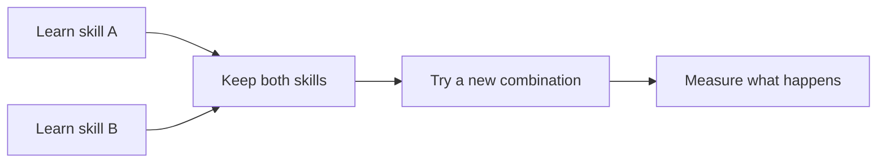

# 🧠 TINY LEARNER

### Learn. Remember. Adapt.

**A compact, CPU-first learning agent exploring how small systems can acquire skills, keep what they have learned, and use those skills in new situations.**

`CPU-FIRST` · `SKILL LEARNING` · `RETENTION` · `NEW COMBINATIONS`

**Meta Global AI Developer Hackathon 2026**

---

## The idea in 20 seconds

Imagine teaching a tiny robot how to **move around an obstacle**. Then you teach it how to **choose a route**.

Now the room changes.

Can it use both skills together instead of needing a new script for every situation?

**That is the problem Tiny Learner explores:** learning skills separately, keeping them available, and trying to reuse them when a task changes.

> **The bigger idea: give small devices the ability to adapt, not just follow instructions.**

## Where could this matter?

Today's project is an **experimental learning system**, not a finished appliance or robot. These examples show the kinds of real-world applications that could benefit if the learning and transfer mechanisms prove reliable and are integrated with suitable sensors, software, and safety controls.

| Potential application | What learning could enable |
| --- | --- |
| **🏠 Home robots** | A robot vacuum that adjusts to rearranged furniture by reusing navigation and obstacle-avoidance behaviors. |
| **🎮 Games and simulations** | An opponent that develops responses to new situations rather than relying only on a fixed library of scripted moves. |
| **🌱 Smart growing systems** | A compact controller that combines learned responses to changing moisture, temperature, and operating conditions. |
| **🏭 Small machines and workshops** | Supervised equipment that adapts among tested routines when conditions change, instead of requiring every combination to be preprogrammed. |
| **🍳 Kitchen and service automation** | A helper that learns recurring task sequences and handles simple changes in order, timing, or workflow. |

**The common thread:** teach a few useful behaviors, retain them, and explore whether they can be combined when the environment changes.

## How Tiny Learner is being tested

Rather than relying on an impressive single demo, we test whether a small learner can:

1. **Learn** a defined behavior from experience.
2. **Remember** earlier behaviors while learning something new.
3. **Adapt** by applying learned skills to combinations it was not trained on directly.

These questions are investigated through controlled tasks, comparisons, and held-out evaluations.

## Why CPU-first?

We are exploring learning with a small computational footprint, on ordinary hardware.

That opens an interesting direction for future devices: **local, lightweight adaptation without needing a large model for every small decision.**

The hardware examples above are possibilities, not current deployments.

## Where Meta Muse fits

**Muse helps with curriculum design and the development of learning challenges.** Tiny Learner is the system being trained and evaluated.

The distinction matters: the goal is to study **what the small learner retains and reuses**, not simply what a larger model can answer on its behalf.

## Project status

**Active research prototype.** Tiny Learner is being evaluated in controlled environments for skill acquisition, retention, and performance on unseen combinations.

Real-world examples in this README are **potential applications**, not products we claim to have built. Experiment configurations, results, and reproducibility materials will be documented as they are verified.

<strong>Research approach and evaluation principles</strong>

We use defined tasks, controlled comparisons, and held-out tests. Outcomes are recorded as `PASS`, `FAIL`, or `UNKNOWN` where applicable. Retention and transfer are measured separately, and limitations remain part of the technical record.

---

### Small enough to explore. Ambitious enough to matter.

**Tiny Learner · Meta Global AI Developer Hackathon 2026**

