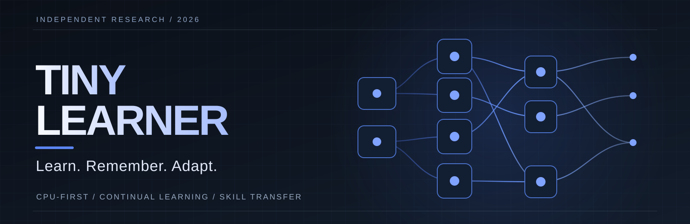
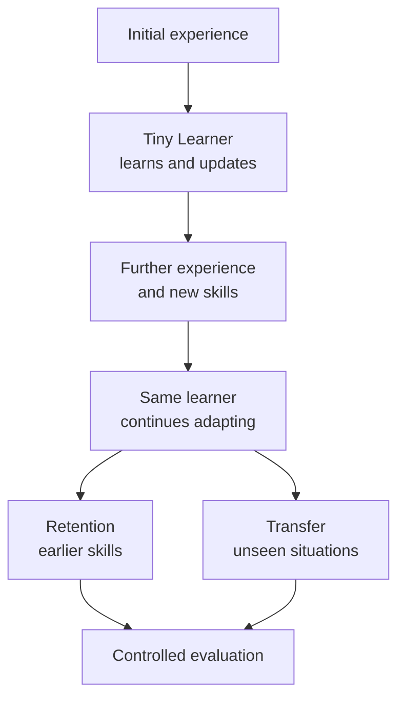

**A compact, CPU-first learning agent exploring how new skills can be acquired, retained, and used in unfamiliar situations.**

Meta Global AI Developer Hackathon 2026

---

## Beyond a fixed set of instructions

A machine can be programmed to perform many tasks. But every new condition creates a harder question: **can it use what it already learned without being taught the exact solution?**

Imagine a robotic arm that has learned to grasp objects, sort components, and deliver them to different stations. Now the objects, layout, and sequence change.

Tiny Learner explores the learning mechanism behind that challenge: **acquiring abilities over time, keeping them available, and applying them in situations the system has not encountered in precisely that form.**

<table>
<tr>
<td align="center" width="33%"><strong>LEARN</strong> Acquire new behavior through experience</td>
<td align="center" width="33%"><strong>REMEMBER</strong> Preserve previously acquired skills</td>
<td align="center" width="33%"><strong>ADAPT</strong> Use familiar skills in new contexts</td>
</tr>
</table>

## Where this could matter

The underlying idea reaches beyond any single device. Small, adaptable learners could eventually contribute to systems such as:

| Field | The opportunity |
| :--- | :--- |
| **Robotic manipulation** | Arms that build a repertoire of grasping, handling, and sorting behaviors, then reuse them when parts or workflows change. |
| **Inspection and maintenance** | Mobile robots combining navigation, measurement, and task-specific responses across unfamiliar layouts. |
| **Agricultural robotics** | Lightweight field machines adapting their learned behaviors to different crops, obstacles, and operating conditions. |
| **Warehouse automation** | Mobile manipulators combining pickup, transport, and placement skills under changing task requirements. |
| **Embedded robotics** | Small devices that improve their behavior locally, without relying on a large remote model for every decision. |
| **Kitchen and service systems** | Assistive machines that adjust learned task sequences as timing, order, and context change. |

The thread connecting them is **learning that carries forward**, not programming each new combination from scratch.

## If it scales...

What begins as a tiny learner could develop into a system with an expanding repertoire of skills.

**More skills. Longer experience. Richer environments.**

The ambition is not only to increase model size. It is to investigate whether a compact learning mechanism can support increasingly complex behavior and, eventually, cooperate with other specialized learners.

---

## From experience to new situations

The important question is not whether a system can perform one trained task. It is **what remains, what changes, and what transfers after it keeps learning.**

## Designed for ordinary hardware

Tiny Learner is built around a **small, CPU-first approach**. Its size makes iterative experiments accessible on everyday computers and motivates a longer-term vision of learning on resource-constrained devices.

## Meta Muse and the learning curriculum

Meta Muse supports the design of learning challenges and experimental curricula. Tiny Learner is the system under evaluation: its ability to learn, retain, and transfer skills is the focus of the project.

## Research

**Active prototype.** Work focuses on skill acquisition, interference, retention, and generalization in controlled environments.

Evaluation methodology

Experiments compare learned behavior against defined controls and held-out tasks. Retention and transfer are examined separately. Protocols use explicit outcomes such as `PASS`, `FAIL`, and `UNKNOWN` where appropriate.

---

**TINY LEARNER**

Learn. Remember. Adapt.

