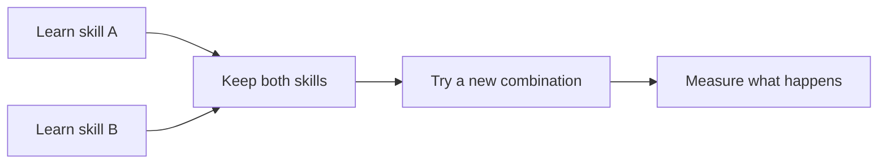

# 🧠 TINY LEARNER

### Learn. Remember. Adapt.

**A compact, CPU-first learning agent exploring how small systems can acquire skills, keep what they have learned, and use those skills in new situations.**

`CPU-FIRST` · `SKILL LEARNING` · `RETENTION` · `NEW COMBINATIONS`

**Meta Global AI Developer Hackathon 2026**

---

## The idea in 20 seconds

Imagine teaching a tiny robot three different skills: **pick up an object**, **avoid a dangerous area**, and **deliver the object to the right place**.

Then change the layout, move the destination, and give it a new task.

Can it **combine what it learned** without being programmed for that exact sequence?

**That is the problem Tiny Learner explores:** learning skills separately, keeping them available, and trying to reuse them when a task changes.

> **The bigger idea: give small devices the ability to adapt, not just follow instructions.**

## Where could this matter?

A small learner becomes especially interesting when a machine needs to **combine familiar actions in an unfamiliar situation**.

| Where it could be used | What adaptation could look like |
| --- | --- |
| **🦾 Robotic arms and sorting stations** | Learn to grasp, classify, and place objects, then combine those skills when the objects or work sequence change. |
| **🔎 Inspection rovers** | Reuse navigation, obstacle avoidance, and measurement skills to inspect machinery or reach a new checkpoint after a route changes. |
| **🌾 Agricultural robots** | Combine movement between crop rows, sensing, and simple handling tasks as plants and field conditions vary. |
| **📦 Warehouse and workshop helpers** | Learn to find a part, pick it up, avoid a restricted area, and deliver it to the correct station in a changing layout. |
| **🤖 Small mobile robots** | Build up a repertoire of actions such as approaching, gripping, transporting, and releasing objects on modest onboard hardware. |
| **🍳 Kitchen and service automation** | Reuse learned task sequences when the order of preparation, timing, or delivery changes. |

**The common thread:** teach a few useful behaviors, retain them, and explore whether they can be combined when the environment changes.

## If it scales...

**What starts as a tiny learner could become a much more capable adaptive system.**

If the same learning mechanism can handle **more skills, longer experience, and more complex environments** without losing what it already knows, the possibilities grow:

- **One learner, many skills.** An agent that keeps expanding its repertoire rather than being rebuilt for each task.
- **Modular, cooperative intelligence.** Specialized learners that contribute different abilities to a larger system.
- **More capable local devices.** Robots, machines, and assistants that handle richer situations while keeping routine decisions close to the device.

The next frontier is learning **how far the same approach can go** as tasks and skill combinations become more complex.

## How Tiny Learner is being tested

Rather than relying on an impressive single demo, we test whether a small learner can:

1. **Learn** a defined behavior from experience.
2. **Remember** earlier behaviors while learning something new.
3. **Adapt** by applying learned skills to combinations it was not trained on directly.

These questions are investigated through controlled tasks, comparisons, and held-out evaluations.

## Why CPU-first?

We are exploring learning with a small computational footprint, on ordinary hardware.

That opens an interesting direction for future devices: **local, lightweight adaptation without needing a large model for every small decision.**

## Where Meta Muse fits

**Muse helps with curriculum design and the development of learning challenges.** Tiny Learner is the system being trained and evaluated.

The distinction matters: the goal is to study **what the small learner retains and reuses**, not simply what a larger model can answer on its behalf.

## Project status

**Active research prototype.** Tiny Learner is being evaluated in controlled environments for skill acquisition, retention, and performance on unseen combinations.

<strong>Research approach and evaluation principles</strong>

We use defined tasks, controlled comparisons, and held-out tests. Outcomes are recorded as `PASS`, `FAIL`, or `UNKNOWN` where applicable. Retention and transfer are measured separately, and limitations remain part of the technical record.

---

### Small enough to explore. Ambitious enough to matter.

**Tiny Learner · Meta Global AI Developer Hackathon 2026**

