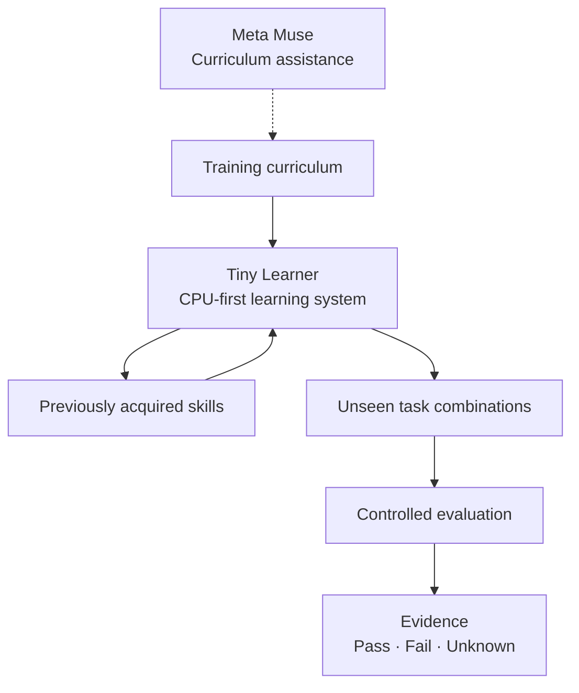

# TINY LEARNER

### Small model. New skills. Real learning.

**Can a tiny, CPU-first learning system acquire new skills without losing the ones it already knows?**

`CPU-FIRST` · `MODULAR LEARNING` · `SKILL RETENTION` · `CONTROLLED EXPERIMENTS`

*An independent research prototype for the Meta Global AI Developer Hackathon 2026.*

---

## The idea

Most AI demos show what a model **already knows**. Tiny Learner asks a different question:

> **What happens when a small learner must acquire a new skill, keep earlier skills, and use them in a combination it has never practiced?**

The goal is not to imitate a large language model. It is to study learning, retention, and recombination in a compact system with measurable behavior.

## The experiment, at a glance

*Conceptual research workflow. The diagram shows what the project is designed to test, not a claim that every capability has been demonstrated.*

## Four questions

| | Research question | What we look for |
| :---: | --- | --- |
| **01** | **Learn** | Can the system acquire a skill from new experience? |
| **02** | **Retain** | Does it preserve previously learned behavior? |
| **03** | **Combine** | Can it apply skills together in unseen situations? |
| **04** | **Measure** | Can we distinguish demonstrated improvement from noise or memorization? |

## Why small?

A compact, CPU-first approach makes it easier to inspect what changes, repeat an experiment, and ask whether additional complexity is actually necessary.

**Small is a design constraint, not proof of intelligence.** Success must come from held-out tests and reproducible evidence, not model size alone.

## Where Muse fits

Meta's Muse models are part of the intended workflow for **curriculum assistance and experiment development**. The learner's behavior is evaluated independently so that assistance from a larger model is not confused with a skill learned by Tiny Learner.

Specific integrations, protocols, and measurements will be documented as they are verified.

## Research principles

- **Measure before claiming.** A good demo does not replace a controlled test.
- **Test unseen combinations.** Performance on practiced tasks is not enough.
- **Track retention.** Learning something new should not silently erase something old.
- **Use explicit outcomes.** Distinguish `PASS`, `FAIL`, and `UNKNOWN`.
- **Make experiments reproducible.** Record configurations, evaluation criteria, and limitations.

## Project status

**Active experimental research.** This repository's public-facing documentation is being prepared. Code, protocols, and validated result summaries will be added selectively as experiments are reviewed.

No benchmark number or generalization claim should be inferred from this overview.

---

**Built for the Meta Global AI Developer Hackathon 2026**

*Learn small. Test carefully. Let the evidence speak.*

